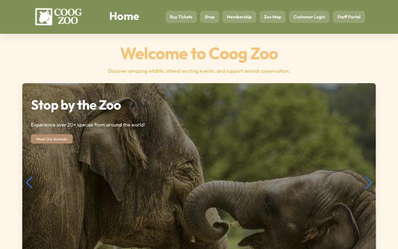
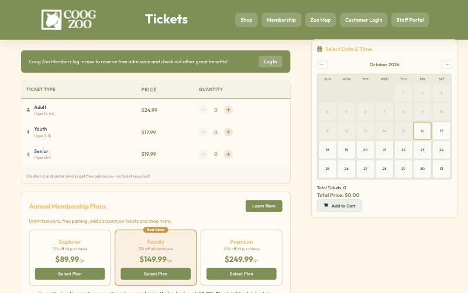
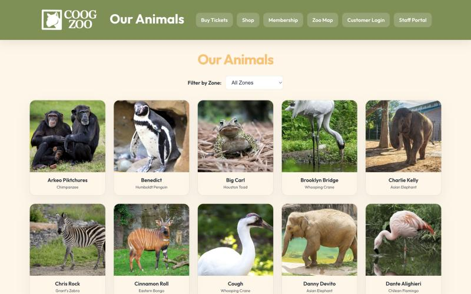
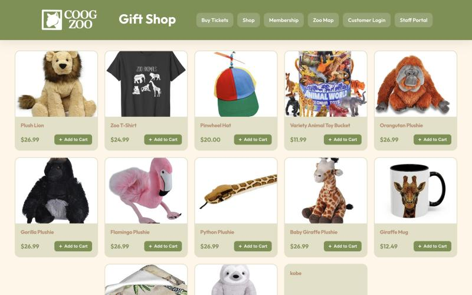

# Coog Zoo

**A zoo operations platform: a public storefront, seven role-scoped staff dashboards, and a MySQL schema that enforces its own rules.**

[](https://zoo-chi.vercel.app)
[](package.json)
[](server/package.json)
[](server/schema.sql)

Guests browse animals, buy tickets, shop, donate and book events. Staff log in to
one of seven dashboards scoped to their role and department — a vet sees the
animals assigned to them, a retail manager sees retail stock, an admin sees the
revenue reports. Behind both is a 28-table MySQL schema that does its own
enforcement: ten triggers raise and clear notifications, and row locks make
overselling impossible rather than unlikely.

Built as a four-person database course project, then taken past the grade: the
backend was rewritten from Supabase onto MySQL, redeployed as a serverless
function, and hardened against the concurrency and authorization bugs the
original didn't handle. [What I built](#what-i-built) separates my work from the
team's.

**Live:** <https://zoo-chi.vercel.app>

---

## What it looks like

| | |
|---|---|
|  |  |
| **Home** — public storefront. | **Tickets** — date-scoped admission, membership plans, running cart total. |
|  |  |
| **Our Animals** — the live roster, read from the database and filterable by zone. | **Gift Shop** — inventory-backed catalog; stock is checked under a row lock at checkout. |

The staff dashboards are behind the login and are not pictured.

---

## The claim worth making

A zoo storefront is a CRUD app in most places and a concurrency problem in
exactly two: the last seat at an event, and the last item on a shelf. Both of
those are sold by many people at once, and both are places where a naive
implementation takes the customer's money for something that isn't there.

**Two concurrent checkouts cannot both sell the last unit.** Every affected row
is locked before anything is written:

```sql
SELECT item_name, stock_count FROM inventory WHERE item_id = ? FOR UPDATE
```

The second transaction blocks on that lock, then reads the *post-decrement*
stock, fails the comparison, and rolls back the entire order with a `409` naming
the item and the quantity actually left. Tickets work the same way against
`max_capacity - actual_attendance`, locking every event in the batch before
inserting a single ticket, so a cart that oversells one of three events buys
none of them.

See [`server/routes/transactions.js:174`](server/routes/transactions.js#L174)
and [`server/routes/tickets.js:105`](server/routes/tickets.js#L105).

**What it replaced.** The original decrement was:

```sql
UPDATE inventory SET stock_count = GREATEST(0, stock_count - ?) WHERE item_id = ?
```

That is the line the fix deleted — see commit
[`3374aad`](https://github.com/marlmelara/zoo/commit/3374aad6a6f07e28494180932c4a273878296ce3).

`GREATEST(0, …)` clamps the column at zero, so stock never went negative and
nothing ever errored. The database looked healthy while customers were charged
for items that did not exist. The bug was invisible precisely because the guard
against it was doing its job on the wrong quantity — it protected the column,
not the customer.

That distinction is the one real lesson in this repo: a constraint that keeps
your data *looking* valid is not the same as a constraint that keeps it *true*.

---

## At a glance

| | |
|---|---|
| **API** | 115 endpoints across 15 route modules, no framework |
| **Schema** | 28 tables, 20 numbered migrations, hand-written SQL throughout |
| **Enforcement** | 10 MySQL triggers; `SELECT … FOR UPDATE` on both oversell paths |
| **Access control** | 6 staff roles × 7 dashboards, resolved against department and assignment tables |
| **Front end** | React 19 + Vite 7, 10 public page areas, 7 dashboards |
| **Deployment** | One Vercel project: static SPA + serverless API, MySQL on Azure |
| **History** | 188 commits, four-person team, Feb–Aug 2026 |

---

## Architecture

One Vercel project serves both halves. The browser gets a static Vite bundle;
`/api/*` is rewritten to a single serverless function that mounts the same
routers the local dev server does.

```
BROWSER
  [ React 19 SPA (Vite) ]
     AuthContext holds the JWT; lib/api.js attaches it to every request
        |
        |  /api/*            (vercel.json rewrite)
        v
API
  [ api/handler.js ]  ──> dispatch()  <──  [ server/index.js ]
     Vercel serverless          |            plain http.createServer
                                |            for local `npm run dev`
                                v
     MOUNTS: 15 routers, matched by server/lib/router.js
                                |
                   requireAuth / requireRole  (JWT, middleware/auth.js)
                   lib/roles.js               (department + assignment scoping)
                                v
DATABASE
  [ MySQL 8 — Azure Flexible Server ]
     mysql2 pool, TLS, UTC
     28 tables · 10 triggers · row locks on the two oversell paths
```

| Piece | Where | What it does |
|---|---|---|
| `dispatch()` | [server/app.js](server/app.js) | One request pipeline shared by local dev and production: reads the body in whatever shape the runtime hands it, adds `res.json`/`res.status`, runs the middleware chain, matches a mount |
| `Router()` | [server/lib/router.js](server/lib/router.js) | Express's routing API — `get/post/patch/put/delete`, `:params`, middleware arrays — in ~60 lines of Node built-ins |
| `requireAuth` / `requireRole` | [server/middleware/auth.js](server/middleware/auth.js) | JWT verification and coarse role gates, returning 401 and 403 |
| `lib/roles.js` | [server/lib/roles.js](server/lib/roles.js) | The fine-grained rules: is this manager's department an animal department, does this employee report to this manager, is this vet assigned to this animal |
| Oversell guards | [transactions.js](server/routes/transactions.js), [tickets.js](server/routes/tickets.js) | `FOR UPDATE` on inventory rows and event rows; whole-order rollback |
| Triggers | [server/migrations/](server/migrations/) | Notifications raised and resolved by the database, not the API |
| `db.js` | [server/db.js](server/db.js) | mysql2 pool; TLS when the host is Azure; `dateStrings` and UTC so dates survive the round trip |
| Migrations | [server/migrations/](server/migrations/) | 20 numbered `.sql` files, applied by a `DELIMITER`-aware runner |

### No Express

`server/package.json` has four dependencies: `mysql2`, `jsonwebtoken`,
`bcryptjs`, `dotenv`. The routing layer is
[~60 lines](server/lib/router.js) that escape the literal parts of a path,
turn `:param` segments into capture groups, and flatten nested middleware
arrays.

This started as a deployment constraint — a Vercel serverless function is handed
a request, not a listening server, and the Express adapter was one more moving
part in a stack already being migrated. Keeping the same `Router()` surface
meant the 15 route modules never learned they had been ported. The cost is real
and worth naming: no battle-tested body parsing, no ecosystem middleware, and
routes are matched by scanning a list rather than a trie.

### How authorization works

Staff carry one of six roles — `admin`, `manager`, `vet`, `caretaker`,
`security`, `retail` — and customers are a separate table with their own login.

Role alone is not enough to answer most of this app's questions. "Can this user
edit this animal?" depends on whether their department works with animals, and
"can this manager deactivate this employee?" depends on who reports to whom.
Those rules live in one file rather than being re-derived per endpoint:

| Helper | Answers |
|---|---|
| `isAnimalDeptManager(user)` | admin, or a manager whose department is Vet / Animal Care — a Retail manager gets `false` |
| `managerOwnsEmployee(user, empId)` | admin, the manager this employee reports to, or the employee themselves |
| `isVetAssignedToAnimal(empId, animalId)` | membership in `vet_animal_assignments` |
| `isCaretakerAssignedToAnimal(empId, animalId)` | membership in `caretaker_animal_assignments` |

Endpoints compose these on top of `requireRole`, so the coarse gate and the
row-level question stay separate. A vet who is not assigned to an animal is a
403, not an empty list.

### How notifications work

Staff notifications are not written by the API. Ten triggers raise them from the
write that caused them, and — the half that is usually missed — clear them when
the condition goes away:

| Fires on | Raised | Resolved |
|---|---|---|
| `supply_requests` | new request notifies the manager and admins | status leaves `pending` |
| `hours_requests` | new submission notifies the manager and admins | status leaves `pending` |
| `inventory` | stock crosses below threshold | stock climbs back above it |
| `operational_supplies` | same, scoped to the owning department | same |
| `animals` | health status becomes sick or critical | status returns to healthy |

Putting this in the database means a restock applied by any path — the API, a
migration, a DBA at a prompt — clears the alert. The same logic in application
code would only clear the alerts raised by that code.

```bash
SHOW TRIGGERS FROM coog_zoo;   # all ten
```

---

## Running it locally

**Requires** Node 20+, MySQL 8+.

```bash
npm install
cd server && npm install && cd ..
```

Create `server/.env`:

```bash
cat > server/.env <<'EOF'
DB_HOST=127.0.0.1
DB_PORT=3306
DB_USER=root
DB_PASSWORD=your-mysql-password
DB_NAME=coog_zoo
JWT_SECRET=change-me
PORT=3001
SEED_PASSWORD=pick-a-password-for-seeded-accounts
EOF
```

Load the database — either the populated dump, or the schema plus migrations:

```bash
mysql -u root -p < coog_zoo_dump.sql          # fastest: schema + triggers + seed data
```

```bash
mysql -u root -p < server/schema.sql           # or build it up
for f in server/migrations/*.sql; do node server/run-migration.mjs "$f"; done
node server/reregister-users.mjs               # re-hash seeded accounts to SEED_PASSWORD
```

Run both halves:

```bash
cd server && npm run dev     # API on :3001
npm run dev                  # SPA on :5173
```

Open <http://localhost:5173>. Customer signup at `/signup` works against a fresh
database; staff accounts come from the seed data.

The dump was produced with
`mysqldump --routines --triggers --events --single-transaction`, so loading it
recreates the triggers too.

---

## What I built

This was a four-person project for a database systems course — Marlon Melara,
Ashley Truong, Connor Sivley, Pablo Velazquez-Bremont — and the team built the
first version together: the original schema, the public pages, the dashboard
layouts, and the visual design.

My own work, which `git log --author` will confirm:

- **The MySQL migration.** The backend originally ran on Supabase. I ported the
  schema, rewrote every query as hand-written SQL against `mysql2`, and moved
  the database to Azure MySQL Flexible Server.
- **The serverless deployment.** The hand-rolled router and the shared
  `dispatch()` pipeline, so one codebase serves `npm run dev` locally and a
  Vercel function in production — including the multi-segment POST routing and
  body-shape bugs that took several commits to pin down.
- **Race-safe checkout.** The `FOR UPDATE` locking on both the inventory and
  event-capacity paths, replacing the `GREATEST(0, …)` clamp described above.
- **Authorization.** `lib/roles.js` and the department/assignment scoping across
  the animal, event, employee and supply endpoints.
- **The notification and activity-log system**, including the ten triggers and
  the lifecycle log.
- **Admin analytics** — event performance, membership insights and shop
  performance, each with date ranges, CSV export and drill-down rows.
- **Timezone correctness** throughout: `dateStrings` plus UTC in the pool, and
  the `toIsoUtc` normalization that stopped dates shifting a day between the
  database and the browser.

My teammates' last commits land on 19 April 2026; every commit after that is
mine, through to August. Most of the work listed above was written in the final
fortnight of the course and after it, on top of the version we built together.

---

## Known limitations

Named here rather than left to be discovered:

- **There is no automated test suite.** Not one test, and no CI. The oversell
  guards were verified by hand against a local database. For a repo whose
  central claim is about concurrent behaviour, a test that actually races two
  checkouts is the most valuable missing piece, and its absence is the honest
  headline of this section.
- **`npm run lint` reports 63 errors and 19 warnings**, all in `src/`. They are
  real: unused bindings, missing hook dependencies, state written during an
  effect. The front end grew fastest under a deadline and it shows. Nothing in
  the API half reports.
- **Animal photographs are hotlinked** to third-party zoo and news sites in the
  seed data. They render today and will rot. The repo already ships local
  images under `src/images/` that should replace them.
- **`POST /api/tickets` and `POST /api/transactions` are unauthenticated** by
  design, so guests can check out without an account. They are therefore
  writable by anyone who finds them. Real payment processing would move this
  behind a provider; there is no payment integration here, and no card data is
  handled or stored.
- **`POST /api/transactions/sale-items` does not use a transaction** and bypasses
  the stock check. It is a leftover path from before the checkout rewrite.
- **Route matching is a linear scan** over ~115 compiled regexes per request.
  Fine at this size, wrong at ten times it.
- **The client bundle is one 1.18 MB chunk** (321 kB gzipped), and the build
  also emits a 4.5 MB PDF and a 4 MB PNG for the zoo map. Nothing is code-split
  and the map is not lazy-loaded; both are one-line fixes that were never
  prioritized.
- **The live demo's database is a student-tier Azure instance.** If it has been
  reclaimed, the API will be up and empty.

Out of scope by choice: payment processing, email delivery, image uploads,
internationalization, and any mobile client.

---

## Repository layout

```
zoo/
├── api/handler.js        Vercel serverless entry → server/app.js
├── server/
│   ├── app.js            dispatch(): the shared request pipeline
│   ├── index.js          local dev http server
│   ├── db.js             mysql2 pool
│   ├── schema.sql        28 tables
│   ├── migrations/       20 numbered .sql files, incl. the triggers
│   ├── routes/           15 modules, 115 endpoints
│   ├── middleware/       JWT auth + role gates
│   └── lib/              router, role scoping, date helpers
├── src/
│   ├── pages/public/     10 guest page areas
│   ├── pages/dashboards/ Admin · Manager · Vet · Caretaker · GenEmployee · Customer · Hours
│   ├── components/       shared panels, paginator, toasts, error boundary
│   ├── api/              typed-ish client helpers, one per resource
│   └── lib/api.js        fetch wrapper, attaches the JWT
├── coog_zoo_dump.sql     schema + triggers + seed data
└── vercel.json           SPA fallback + /api/* rewrite
```

---

## Contact

Marlon Melara — <marlonmelara96@gmail.com>
